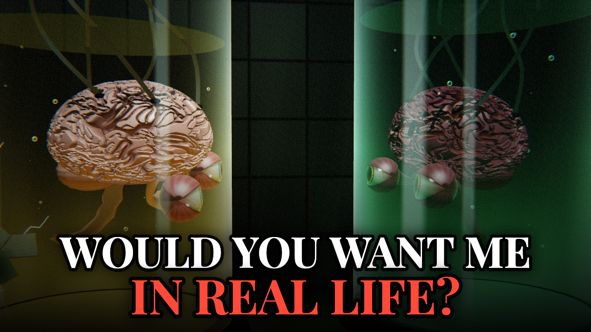

# Brain in a Vat

Source code for the [Brain in a Vat music video](https://www.youtube.com/watch?v=se3VRTsLnOA), about two brains in neighbouring jars who fall in love.

[](https://www.youtube.com/watch?v=se3VRTsLnOA)

**Watch it on YouTube:** <https://www.youtube.com/watch?v=se3VRTsLnOA>

## Credits

- **Music:** generated with Suno v6, steered by Simon Strandgaard: <https://suno.com/s/ujx93IhFmPpNpt5V>
- **Lyrics:** written by GPT-6 Astra, steered by Simon Strandgaard ([`assets/lyrics.txt`](assets/lyrics.txt))
- **Visuals:** Claude (Claude Code, Fable 5.2), steered by Simon Strandgaard, built on experiments from
  [vibe-coding-lab](https://github.com/neoneye/vibe-coding-lab)
- This repo started as a fork of John Heibel's [PDoomVideo](https://github.com/JohnHeibel/PDoomVideo)

## How it was made

Every prompt is in [`prompts/`](prompts/README.md); the design is in
[`docs/superpowers/specs/`](docs/superpowers/specs/2026-11-15-brain-in-a-vat-music-video-design.md).
The standalone experiments in [`assets/`](assets/) were ported into scene modules:

| Scene | From | What it shows |
|---|---|---|
| [`lab`](video/src/scenes/lab.js) | `assets/brain-in-a-vat` | The two brains in their jars: eyes on stalks, singing, the leak, the nurse's shadow, the curtain |
| [`sim`](video/src/scenes/sim.js) | new | The simulation: a too-bright beach house where they have bodies, and it glitches |
| [`shatter`](video/src/scenes/shatter.js) | `assets/glass-shatter` | The nightmare at the bridge: the jar marked YOU falls and breaks |
| [`water`](video/src/scenes/water.js) | `assets/watercolor-text` | Chorus words in red paint, hit by drops on the beat |
| [`ink`](video/src/scenes/ink.js) | `assets/ink-chromatography` | Handwritten love notes separating into colour bands in water |
| [`dust`](video/src/scenes/dust.js) | `assets/dust` | Messages written with a finger on a dusty jar, the brain visible through the strokes |
| [`terminal`](video/src/scenes/terminal.js) | new | His console during the rap |

Subtitles come in six formats ([`video/src/overlay.js`](video/src/overlay.js)): breath on glass, specimen label,
handwriting, karaoke capitals, terminal prompt and plain captions. Word timings come from faster-whisper aligned to the
lyric sheet ([`tools/align.py`](tools/align.py)); the beat grid and loudness from [`tools/analyze.mjs`](tools/analyze.mjs).
The shot list is [`video/src/timeline.js`](video/src/timeline.js); the contract every scene follows is
[`video/SCENES.md`](video/SCENES.md). Who sings each line (`who` in [`video/src/lyrics.js`](video/src/lyrics.js)) is a guess.

## Rendering

You need Node.js, Google Chrome and ffmpeg.

```bash
npm install
node video/serve.mjs                                   # live player at http://localhost:8040/video/
node video/render.mjs --frames=0:343.16 --workers=4    # every frame into out/frames (resumable)
node video/render.mjs --encode --out=out/brain-in-a-vat.mp4
node video/render.mjs --thumbs=docs/thumbnails         # the three YouTube thumbnail candidates
```
